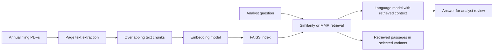

# Financial Filings RAG

A document research workbench for reading Amazon, Alphabet, and Microsoft annual filings, with inspectable experiments across OpenAI, Gemini, DeepSeek, and Ollama.



The work is presented as an analytical process: frame the research question, inspect source documents, implement alternatives, trace answers to evidence, and identify where the method can fail. **It is a research prototype, with no recorded model ranking or measured business impact.**

## Start with the evidence

| Review question | Where to look |
| --- | --- |
| How was the document research problem framed? | [Analyst case study](docs/analyst-case-study.md) |
| Which approaches were implemented? | [Experiment catalogue](docs/experiments.md), including 16 distinct implementations |
| What does the application actually do? | [OpenAI application](apps/openai_pdf.py) and [reproduction guide](docs/reproduction.md) |
| Are the inputs comparable and traceable? | [Data guide](data/README.md) and [SHA-256 manifest](data/manifest.csv) |
| What is supported by verification? | [Verification record](docs/verification.md) |
| What remains unresolved? | [Limitations and evaluation protocol](docs/evaluation.md) |

## Findings from implementation review

- The corpus contains three FY2024 filings, but Microsoft's year ends on **June 30**, while Amazon's and Alphabet's end on **December 31**. Cross-company comparisons must retain those period labels.
- Chunk configurations range from **500 characters / 50 overlap** to **5,000 / 500**. These are implemented alternatives; there is no controlled evidence that larger chunks improve answers.
- Several variants retrieve **4 passages** using MMR from **20 candidates**, with `lambda_mult=0.7`. The primary OpenAI application uses the library's default similarity retrieval.
- An Ollama generator does not make every pipeline local: the financial Ollama variant uses **Google embeddings**. A separate Ollama baseline performs both embeddings and generation locally.
- Displayed chat history is not always model context. The primary application shows prior turns but submits only the latest question. History-enabled experiments submit history and instructions as part of the retrieval query, which can also change retrieval relevance.

These are source-code and document findings, not accuracy results. No answer transcripts, labeled benchmark scores, latency logs, or cost measurements were supplied.

## Run the primary application

Use Python 3.12 and run commands from the repository root:

```powershell
python -m venv .venv
.\.venv\Scripts\Activate.ps1
python -m pip install -r requirements-lock.txt
$env:OPENAI_API_KEY = "your-own-key"
python -m streamlit run apps/openai_pdf.py
```

Upload one or more PDFs from `data/filings/`, then ask a question. To change the uploaded corpus, start a fresh Streamlit session: the current application caches its first index for that session. The [reproduction guide](docs/reproduction.md) covers all providers and the dependency constraints.

**Credentials:** supply your own API keys through environment variables. [`.env.example`](.env.example) lists names only; `.env` is ignored and is not automatically loaded. No shared API key is distributed. See [credential handling](SECURITY.md).

## Repository layout

```text
apps/                   Primary OpenAI PDF application
experiments/baselines/  Plain chat, PDF retrieval, generic-history controls
experiments/retrieval/  Financial prompt with 4,000-character chunks
experiments/financial/  Financial prompt with 5,000-character chunks
experiments/connectivity/  Provider connection probes, not accuracy tests
data/                   Filing snapshots, metadata, and checksums
docs/                   Case study, design comparison, evaluation, reproduction
scripts/                Offline repository integrity verification
```

## Scope and context

Developed by [xtan0701](https://github.com/xtan0701) in the context of an AI Essentials for Business RAG project. The project brief references the [JHU-CDHAI technical manual](https://github.com/JHU-CDHAI/Chatbot-AIEB) for environment and application setup. This repository focuses on the financial-document application and its implemented alternatives. It does not assert that RAG, FAISS, or the underlying framework designs are original inventions.

The filing snapshots remain third-party company disclosures. Code and data are presented for inspection; no blanket license is applied to third-party materials.

中文导读：本项目保留完整的技术探索，包括模型接入、通用问答、分块参数、财务提示词、检索与多轮交互方案。建议先读分析案例，再对照实验目录查看代码。已实现的方案、此次核验的结果和尚未完成的评估分别说明，不把方案数量当作性能证明。
